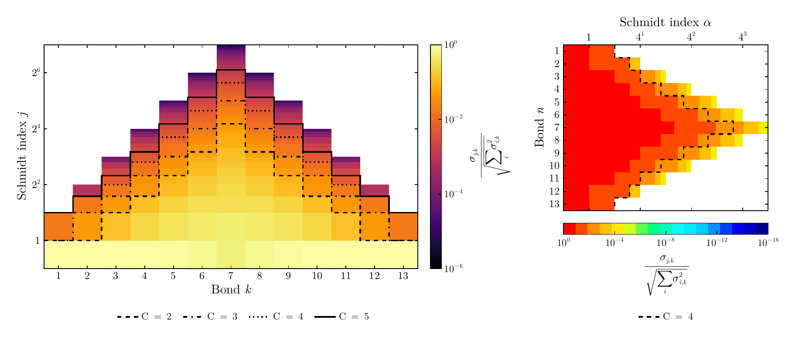
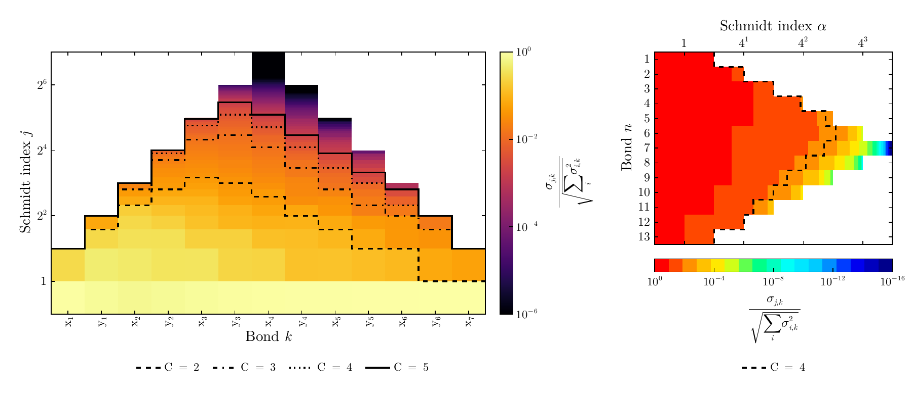
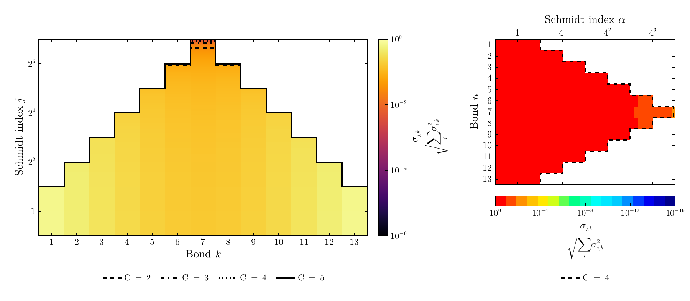

# ITensorSchmidtPlots.jl

Schmidt-spectrum heatmaps and PDF export for Julia's ITensors and ITensorMPS.
Plot normalized singular values at every MPS bond, with stepped contours showing
the minimum retained rank for specified discarded-weight cutoffs.

`schmidtplot` / `schmidtplot!` and `schmidttruncation` / `schmidttruncation!`
are native Makie recipes: use normal Makie axes, figures, attributes, layouts,
themes, legends, and colorbars. Numerical spectrum extraction and truncation
analysis are separate from plotting, and accept precomputed spectra too.

Two paper-inspired presets are included:

| Preset | Layout | Color scale | Reference |
| --- | --- | --- | --- |
| `:paper2026` | Bond horizontally; Schmidt index on a log₂ vertical axis | Inferno, default 10⁻⁶ to 1 | [Esmaeili et al., Figure 6](https://arxiv.org/abs/2608.28869) |
| `:paper2022` | Bond vertically, increasing downward; Schmidt index on a logarithmic horizontal axis with powers of 4 | Discrete red-to-blue, default 1 to 10⁻¹⁶ | [Gourianov et al., Supplementary Figure 1](https://arxiv.org/abs/2106.05782) |

The presets reproduce the visual conventions, not the papers' underlying data.
No Python, external LaTeX installation, display server, or GPU is required.
PDF labels and contours are vectors by default; `rasterize=true` can reduce the
size of very large heatmaps while preserving vector text and contours.
The presets and examples use bundled Computer Modern fonts (the New Computer
Modern family), with LaTeX-rendered mathematical symbols and labels. The examples have no figure
titles, panel titles, or explanatory captions; only axes, colorbars, and cutoff
legends are included. A title is added only if you explicitly pass `title=...`.

## Installation

Requires Julia 1.10 or later. Install directly from the public GitHub repository;
the package is **not registered in General**:

```julia
using Pkg
Pkg.add(url="https://github.com/ElHirad/ITensorSchmidtPlots.jl")
```

For the reproducible initial release, add `rev="v0.1.0"` to that call.
Julia installs CairoMakie and the other dependencies automatically; the first
import may take a few minutes. This is a standalone package and does not require
ITensorMPSDraw or this development workspace.

To install this folder, including after copying it to another computer:

```julia
using Pkg
Pkg.develop(path="/absolute/path/to/ITensorSchmidtPlots")
```

## Quick start

```julia
using ITensors, ITensorMPS, ITensorSchmidtPlots

sites = siteinds("Qubit", 14)
psi = random_mps(sites; linkdims=32)

data = schmidt_spectrum(psi)  # Does not change psi
save_schmidt("schmidt.pdf", data;
    cutoffs=[1e-2, 1e-3, 1e-4, 1e-5])

save_schmidt("schmidt_vertical.pdf", data;
    style=:paper2022, cutoffs=[1e-4])
```

`save_schmidt("schmidt.pdf", psi)` also works. Files are written to your current
directory unless you supply a full path; existing files at that path are replaced.
Only PDF filenames are accepted. Other formats are not generated by this API.

## What is computed

At bond `k`, partition the represented state into sites `1:k` and `k+1:N`.
The singular values of this matricization are the Schmidt coefficients.
The implementation resets the gauge metadata on a deep copy, right-canonicalizes
it, and sweeps through the orthogonality centers, taking an untruncated SVD at
each internal bond. It does not build the exponentially large dense state.
It supports real, complex, and QN-conserving finite open-boundary MPSs with one
link between neighboring tensors. Values are returned as Float64 vectors.

By default, every bond's vector is normalized so `sum(abs2, s) == 1` to
floating-point precision. Use `schmidt_spectrum(psi; normalize=false)` to retain
the state norm. Raw values can be plotted with suitable `colorrange` bounds
(or `color_limits` in the preset helpers).
The input tensors, site/link indices, and orthogonality metadata are preserved.
The default `svd_alg="qr_iteration"` favors accuracy; ITensors-supported
alternatives may be passed explicitly.

### Truncation semantics

For each bond, the contour is the **smallest** integer `χ ≥ 1` satisfying

```math
\frac{\sum_{j>\chi}\sigma_{j,k}^{2}}{\sum_j\sigma_{j,k}^{2}} \leq \epsilon,
\qquad \epsilon=10^{-C}.
```

Thus `cutoff=1e-4` bounds the relative single-bond reconstruction error in the
Euclidean/Frobenius norm by `sqrt(1e-4) = 0.01`. A cutoff of `1e-2` bounds it by
`0.1`. A squared-weight tolerance is not a singular-value-amplitude threshold.
This package uses `≤`, accepting equality, rather than the strict `<` in the
2026 paper's displayed criterion. The legend's `C` is `-log10(cutoff)`.

```julia
p = truncation_profile(data; cutoff=1e-4, maxdim=64)
p.ranks               # Retained rank at each bond
p.discarded_weights   # Actual relative discarded squared weight
p.meets_cutoff        # False if maxdim forces excessive discarded weight
```

The curves describe **independent cuts of the supplied state**. They are not a
promise about the final ranks or global error after a sequential truncation of
all bonds. Neighboring truncations change the state and its subsequent spectra.
Use the original MPS to inspect proposed discarded values: coefficients removed
before calling this package cannot be recovered. Spectra computed on an already
compressed MPS describe that compressed state only.

### Reading the heatmaps

- Horizontal/vertical position identifies a bond and the coefficient's rank.
- Color is the singular value, not its square, on a logarithmic color scale.
- Rank-j cells end at `j`, so the contour at `χ` encloses exactly `χ` values.
  The first cell starts at `1/2` because zero is undefined on a logarithmic axis.
- Exact zeros and unavailable values are blank. Positive values below the color
  floor use the lowest color; no positive tail values are silently removed.
- Tiny nonzero coefficients near machine precision can be numerical roundoff.
  A default 10⁻¹⁶ color floor does not establish physical accuracy to 16 digits.
- A `maxdim` cap that misses a tolerance is marked “cap limited” in the legend.

## Native Makie interface and customization

The native recipes follow the same calling conventions as `heatmap` and `lines`:

```julia
using ITensorSchmidtPlots, CairoMakie, LaTeXStrings

# `data` is the SchmidtSpectrum computed above; an MPS also works directly.
fig, ax, hm = schmidtplot(data;
    colormap=:inferno,
    colorrange=(1e-8, 1.0),
    colorscale=log10,
    axis=(xticks=1:2:length(data.values), ylabel=L"j"),
    figure=(size=(900, 450), fonts=theme_latexfonts().fonts))

cb = Colorbar(fig[1,2], hm;
    label=L"\sigma_{j,k}",
    ticks=([1e-8, 1e-4, 1.0], [L"10^{-8}", L"10^{-4}", L"1"]))

curve = schmidttruncation!(ax, data;
    cutoff=1e-4, color=:cyan, linestyle=:dash, linewidth=2,
    label=L"\epsilon = 10^{-4}")
leg = axislegend(ax; position=:rt, framevisible=false)

# Ordinary Makie changes; the linked colorbar follows the heatmap.
hm.colormap = :viridis
hm.colorrange = (1e-7, 1.0)
ax.xticks = 1:length(data.values)
curve.linewidth = 3
save("custom.pdf", fig; pt_per_unit=1)
```

`schmidtplot(data)` returns Makie's usual `FigureAxisPlot`, which destructures
as `(fig, ax, plot)`. `schmidtplot(fig[1,1], data)` returns `AxisPlot`, and
`schmidtplot!(ax, data)` returns the plot and preserves your existing axis settings.
For an existing axis, set `yscale=log2` yourself, or use `xscale=log2` for vertical
bonds. The non-mutating recipe supplies suitable default axes automatically.

| Control | Standard Makie interface |
| --- | --- |
| Colors | `colormap`, `colorrange`, `colorscale`, `lowclip`, `highclip`, `nan_color`, `alpha` |
| Ticks, labels, limits, scales | `axis=(...)`, axis attributes, `limits!`, `xlims!`, `ylims!` |
| Colorbar | `Colorbar(position, hm; ...)`, placed wherever you choose |
| Legend | `axislegend(ax; ...)` or `Legend(position, ax; ...)`; omit to hide |
| Truncation curves | Any number of `schmidttruncation!` calls; line colors, widths, styles, labels |
| Orientation | `orientation=:horizontal` or `:vertical`, on both recipes |
| PDF size and typography | `figure=(...)`, `theme_latexfonts()`, `save(...; pt_per_unit=1)` |
| Large heatmaps | `rasterize=true`; text and curves remain vectors in PDFs |

Colors and colorbar ticks are in **singular-value units**, including when the
color scale is logarithmic. The default color range is `(1e-6, 1.0)`. Use
`figure=(fonts=theme_latexfonts().fonts,)` or `with_theme(theme_latexfonts())` to
give all figure text Computer Modern fonts. Use LaTeXStrings (`L"..."`) for math.
No title, caption, legend, or colorbar is automatically added by the native recipe.

For changing data, pass an `Observable(data)` to both recipes and assign a new
`SchmidtSpectrum` to it. Ranks may change, but the number of bonds must stay the
same; recreate the plot for a different chain length. `cutoff` and `maxdim` are
updatable plot attributes. Axis ticks and existing legend entries follow ordinary
Makie behavior: update ticks or rebuild a legend when its labels need to change.

See [examples/native_makie.jl](examples/native_makie.jl) for a complete runnable
example, including a separate legend and five independently styled curves.

## Paper presets and multi-panel figures

`plot_schmidt` (with an underscore), `plot_schmidt!`, and `save_schmidt` are
convenience layout helpers with their own documented keywords. Use the native
recipes above when you want unrestricted Makie composition and styling.

```julia
fig = plot_schmidt(data;
    style=:paper2026,
    bond_labels=["bond $k" for k in eachindex(data.values)],
    color_limits=(1e-8, 1.0),
    cutoffs=[1e-3, 1e-5],
    size=(900, 450))

using CairoMakie
save("custom.pdf", fig; pt_per_unit=1)

fig = Figure(size=(1100, 500), fonts=theme_latexfonts().fonts)
plot_schmidt!(fig[1,1], data; style=:paper2026)
plot_schmidt!(fig[1,2], data; style=:paper2022, cutoffs=[1e-4])
save("comparison.pdf", fig; pt_per_unit=1)
```

`plot_schmidt!` returns the axis, colorbar, profiles and contour plot objects for
further Makie customization. These preset helpers support at most four cutoff curves, using
the four black line styles in the reference. Empty `cutoffs=[]` hides contours.
`SchmidtSpectrum(vectors; normalized=true)` also accepts precomputed, sorted,
nonnegative spectra; the constructor validates and copies the data.

## Three reproducible examples

From this package directory:

```sh
julia --project=. -e 'using Pkg; Pkg.instantiate()'
julia --project=. examples/make_examples.jl
julia --project=. -e 'using Pkg; Pkg.test()'
```

The generator writes three PDFs to `output/pdf/`, each with both reference
layouts, plus CSVs of all coefficients and truncation ranks, and `VALIDATION.md`.

1. **Nonuniform entangled pairs:** seven mirrored pairs over 14 qubits. Every
   coefficient can be calculated analytically as a product of pair coefficients.
2. **Synthetic multiscale field:** a 128 × 128 field containing Fourier modes
   and a localized oscillation, encoded using interleaved coarse-to-fine x/y bits.
   This is not DNS data from either paper.
3. **Complex random state:** a seeded, normalized Gaussian state over 14 qubits,
   which provides a broad, highly entangled comparison.

The reviewed examples are available as PDFs:
[entangled pairs](docs/examples/01_entangled_pairs.pdf),
[multiscale field](docs/examples/02_multiscale_field.pdf), and
[complex random state](docs/examples/03_complex_random.pdf).
Their [numerical validation report](docs/examples/VALIDATION.md) records all
156 independently checked truncation ranks.





Every bond is checked against an independent dense matrix SVD of the original
vector. Every displayed cutoff rank is checked for both sufficiency and
minimality. The tests also cover QN blocks, gauge invariance, stale gauge
metadata, raw normalization, input preservation, invalid inputs, exact cutoff
boundaries, rank caps, PDF export, native Makie composition, linked colorbars,
legends, and reactive updates to data and plot attributes.

## License and references

MIT licensed. The source references motivate the visual styles; no paper figures
or third-party datasets are redistributed with the package.

- [Gourianov et al., *A Quantum Inspired Approach to Exploit Turbulence Structures*, Supplementary Figure 1](https://arxiv.org/abs/2106.05782).
- [Esmaeili et al., *A priori Assessment of Tensor-Network Encoding for Isotropic Turbulent Flows*, Figure 6](https://arxiv.org/abs/2608.28869).
- [ITensorMPS documentation: MPS and MPO examples](https://docs.itensor.org/ITensorMPS/stable/examples/MPSandMPO.html).
